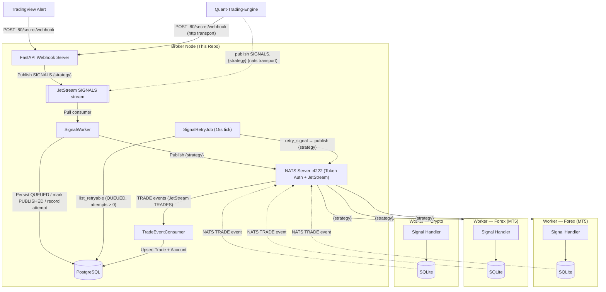

# Architecture



## Signal producers

Both producers speak the same [`WebhookPayload`](api.md#post-secretwebhook); the broker cannot tell them apart, and nothing downstream — persistence, block gate, fan-out, broadcast — branches on the origin.

| Producer | How it reaches the broker | Auth |
| -------- | ------------------------- | ---- |
| **TradingView** | `POST /secret/webhook` from the alert's webhook URL. | In-payload `token` (= `WEBHOOK_SECRET`). TradingView cannot attach custom headers, so there is no signature header. |
| **[QTE](https://github.com/rockingrow/quant-trading-engine)** — `http` transport | The same `POST /secret/webhook`. The right choice when QTE and the broker do not share a trusted NATS cluster. | Same as above. |
| **[QTE](https://github.com/rockingrow/quant-trading-engine)** — `nats` transport (its default) | Publishes `{"payload": {...}}` straight to the JetStream subject `SIGNALS.<strategy>` — the very buffer the webhook writes to — so the signal keeps the broker's persistence and retry without the HTTP hop. | **Access to the NATS cluster is the auth**: this path skips the `token` check, so keep that cluster private (or token-protected). |

QTE pins what it relies on in its own [`docs/broker-contract.md`](https://github.com/rockingrow/quant-trading-engine/blob/main/docs/broker-contract.md); this repo's schema stays the source of truth, so a field added here (e.g. `position.use_equity_sizing`) is what that page tracks.

---

## Project Structure

```text
algo-trading-broker/
├── broker/
│   ├── api/             # FastAPI routers: api.py (v1), admin.py, telegram.py, webhook.py
│   ├── db/              # SQLAlchemy models, async engine, repository/ (one module per aggregate)
│   ├── domain/          # Domain policies (e.g. trade-status state machine)
│   ├── helpers/         # Signal, timeframe, and message-formatting utilities
│   ├── interfaces/      # Protocols for DI (DB, notifier, publisher)
│   ├── schemas/         # Pydantic schemas (webhook, publisher, subscriber, trade, account, admin)
│   ├── security/        # Auth guard (ensure_api_key — X-API-KEY)
│   ├── services/        # nats_service, notification_service, jetstream_worker (pull loop),
│   │                    #   signal_processing_service (+ SignalWorker), signal_retry_job
│   ├── app.py           # FastAPI application factory
│   ├── main.py          # Entrypoint (uvicorn runner)
│   ├── router.py        # Aggregates sub-routers under /v1, /admin, /secret
│   ├── providers.py     # Dependency-injection providers
│   ├── nats.py          # NATS connection lifecycle (connect/drain/close)
│   ├── openapi.py       # Shared OpenAPI response definitions
│   ├── constants.py     # Broker setting keys
│   ├── logger.py        # Logging configuration
│   └── settings.py      # Pydantic settings (grouped sub-models) loaded from .env
├── bot/                 # Telegram bot service (aiogram v3) — see bot/README.md
│   ├── app/             # handlers, services, middlewares, keyboards, presenters, utils
│   └── tests/           # Bot pytest suite (own pyproject.toml / uv project)
├── alembic/             # Alembic migration environment and version scripts
├── bruno/               # Bruno API client collections
├── config/tailscale/    # Tailnet policy (ACL) and the Serve forwards of the tailscale container
├── examples/            # Example webhook / NATS / worker JSON payloads
├── scripts/             # Utility scripts (docker-entrypoint, ensure_keys)
├── tests/               # Pytest unit tests
├── Makefile             # Automation shortcuts (uv, Docker, Alembic, linters)
├── Dockerfile           # Production container definition
├── docker-compose.yml   # Infrastructure (PostgreSQL + NATS + Broker, optional Tailscale)
└── pyproject.toml       # uv dependencies & tool config
```
